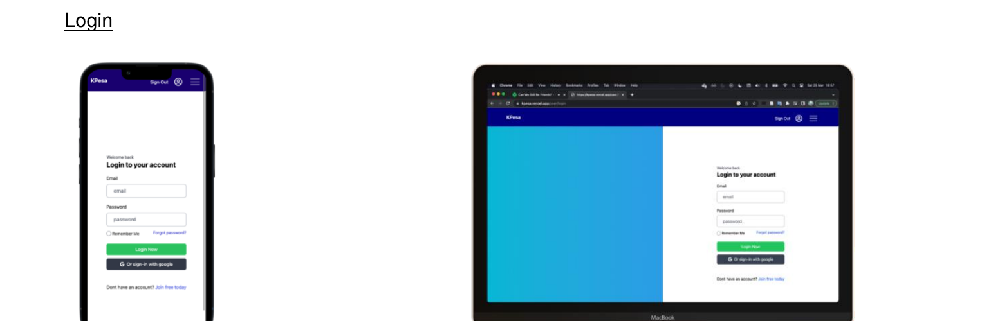
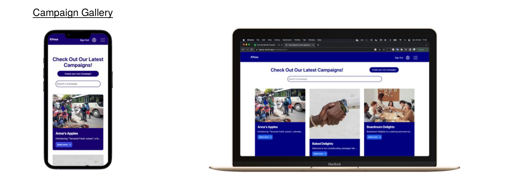
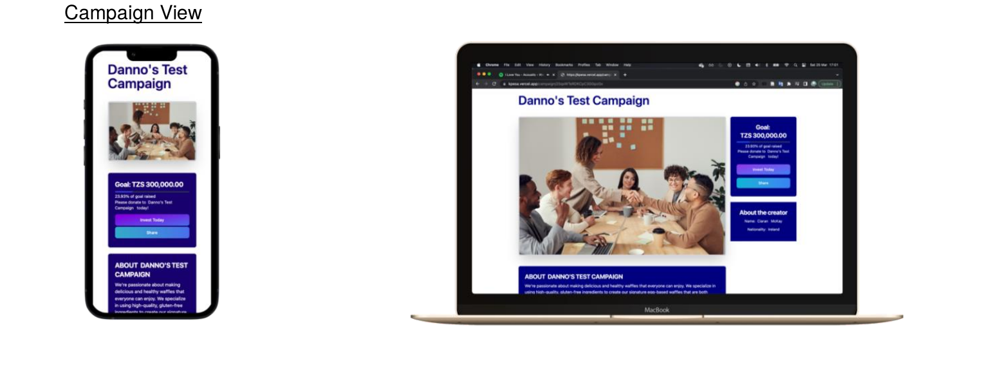
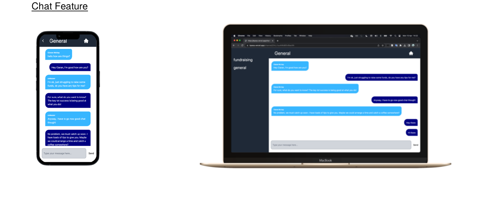
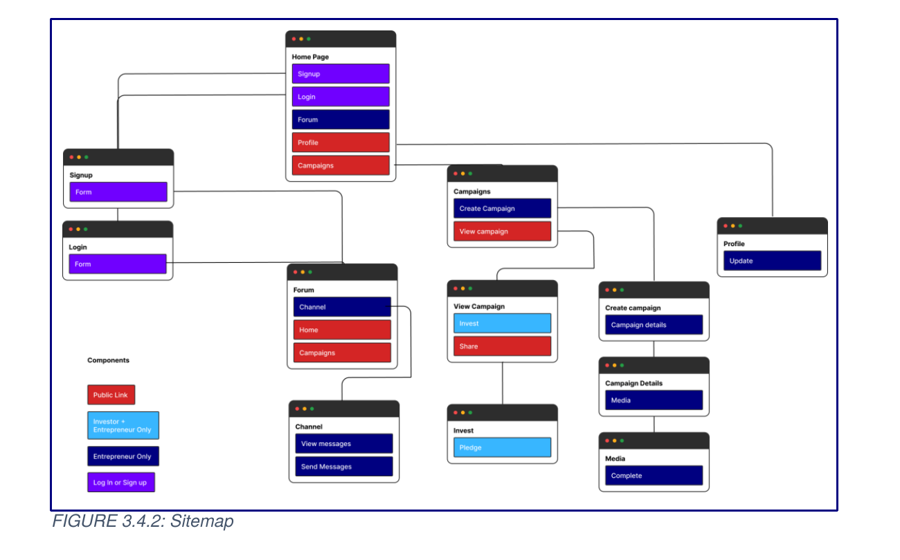

# KPesa

KPesa is a crowdfunding web app I built as my final year project at Trinity College Dublin (MSISS, 2023), for a real client: KPesa, a social enterprise founded by Leyla Faru that uses crowdfunding to help close the financing gap for female entrepreneurs in Tanzania.

Africa is the only continent where female entrepreneurs outnumber men, yet most remain unbanked and locked out of traditional bank loans. My research phase looked at what actually drives and blocks female entrepreneurship in Tanzania (motivations, access to capital, the role of community), the different crowdfunding models available, and Tanzania's regulatory landscape. Those findings directly shaped what got built: a community-first, mobile-first platform rather than a generic donation page.

📄 **[Read the full project report](docs/KPesa-FYP-Report.pdf)** — covers the research on female entrepreneurship in Tanzania, the crowdfunding models considered, the regulatory landscape, and the full technical writeup.

## What it does

**Two people log in as different user types**, and the app routes them accordingly:

- **Entrepreneurs** get access to a community chat and can launch a funding campaign.
- **Investors** browse campaigns and pledge to the ones they want to support.

**Campaigns.** An entrepreneur fills out a multi-step form (name, funding target, category such as food, agriculture, property, construction, retail, or education, and a description) to create a campaign. Investors then browse a gallery of live campaigns, open one to see its goal and progress, and pledge through a guided flow (details → investor info → pledge amount → review → confirmation). Each pledge writes to Firestore and the campaign's progress bar updates live.

**Community chat.** This was the feature the research pointed to most directly: entrepreneurs in Tanzania are often isolated from the kind of informal networking and mentorship that helps a business idea take shape. Rather than bolting on Slack or Discord (both far too data-heavy for a market where most people are on limited mobile data), I built a proprietary real-time chat with admin-defined channels, so users can talk to each other without leaving the app or burning through data.

**Built for low bandwidth.** With internet access in Tanzania sitting around 37% and most of that mobile-only, the whole app is designed mobile-first: Next.js pre-rendering so pages don't load blank, Tailwind for lean CSS, and a lightweight chat feature purpose-built instead of a heavier third-party one.

## Screenshots

**Login** — Google or email/password sign-in, routing entrepreneurs and investors to different parts of the app.



**Campaign gallery** — investors browse live campaigns across categories like food, agriculture, and construction.



**Campaign view** — goal, live progress bar, and the option to pledge or share.



**Community chat** — the proprietary, low-bandwidth chat feature entrepreneurs use to connect with each other.



**Sitemap** — how the three access levels (public, investor, entrepreneur) map onto the app's pages.



## How it's put together

- **Next.js 13 + React 18** on the front end, using pre-rendering so the app stays fast on slower mobile connections.
- **Firebase** for everything on the back end: Authentication (Google sign-in and email/password) and Firestore as the database. Firestore's document model let me use hierarchical sub-collections, for example each campaign has a `pledges` sub-collection, and each chat channel's messages are scoped to it, so queries stay fast without needing to search the whole database.
- **Tailwind CSS** for styling, chosen for how quickly it lets you build UI without leaving your components.
- **react-hook-form** for the multi-step forms (signup, campaign creation, pledging).
- Real-time updates throughout (chat, campaign pledge totals) use Firestore's `onSnapshot` listeners, so the UI updates without the user refreshing.

### Project layout

```
components/     Reusable building blocks, grouped by feature
  campaigns/    Campaign cards and listings
  investment/   The pledge flow (steps, review, success)
  login/        Login form
  signup/       Signup form
  steps/        Generic multi-step form scaffolding
context/        Auth state, multi-step form state, user data
hooks/          useAuth (wraps Firebase auth + Firestore), useInput
pages/          Next.js routes: campaign viewer/creation, chat channels, dashboard, profile
public/images/  Static assets, including the KPesa logo
```

Pages are the routes; components are the reusable pieces pages assemble. For instance, the campaign creation page composes `CampaignDetails.js`, `Details.js`, and `Media.js` inside a `Stepper.js` wrapper, so the same stepper pattern is reused for the investment pledge flow too.

## Why these choices

A few decisions were shaped directly by the client and the market rather than personal preference:

- **No off-the-shelf chat tool.** Discord and Slack's mobile apps run into the hundreds of MB to install, a real barrier on limited data plans. A proprietary chat feature kept the app's footprint small and kept the community entirely inside KPesa, rather than sending users off to a third-party app.
- **Firebase over a SQL backend.** With a non-technical founder and no in-house engineering team, Firebase's simpler API and lack of upfront schema design meant lower long-term maintenance overhead for whoever picks this up next.
- **Next.js pre-rendering over plain client-side React.** In a client-side rendered app the user sees a blank page while JavaScript loads; pre-rendering sends constructed HTML immediately, which matters a lot on a slow connection.
- **The campaign flow is deliberately generic** (not tied to a specific funding model like loans or equity) because KPesa hadn't yet settled on a business model when this was built. It's meant as a foundation the client can adapt once that's decided.

## Status

This was delivered as a working prototype, not a production system. There's no automated test suite (testing was manual, unit and integration style, documented in the project report), no payment gateway integration, and no Firestore security rules included. The full project report, including the research, regulatory analysis, and recommendations for what KPesa needs to do next (a payment gateway strategy, fraud protection, investor education), was submitted separately as part of the FYP.
